# Ishaan Rai
### AI/ML Engineer · Full-Stack Developer · Product Builder

*Turning curious ideas into useful, intelligent products.*

[Portfolio](https://glowup-theta-eight.vercel.app/) · [GitHub](https://github.com/Ishaan-Rai09)

## Three things I build

  
  
  

## Activity, in motion

  
  

## Selected work

  
  

  
  

---

Designed as SVG · Rendered with Python · Refreshed daily

